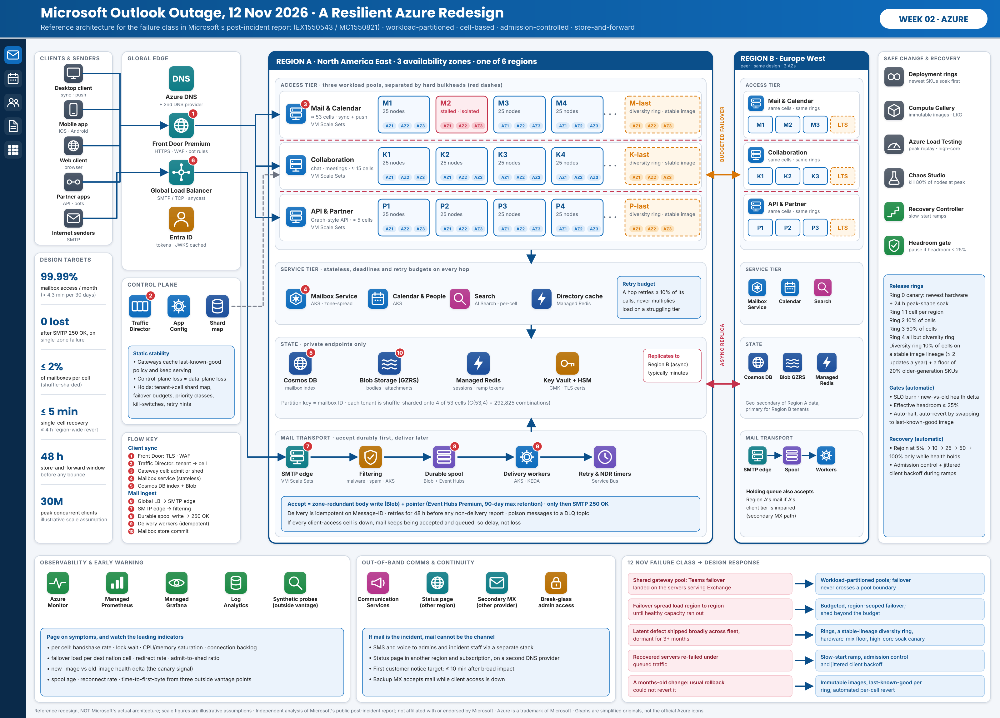

# Microsoft Outlook outage (12 Nov 2026): an Azure resilience deep dive

Independent analysis of Microsoft's public post-incident report (PIR, incident IDs EX1550543 / MO1550821), plus a reference Azure redesign for the same failure class.

## Important
- Incident facts come from Microsoft's PIR. Verify against Microsoft's own channels before quoting.
- The architecture is **my own reference redesign, not Microsoft's actual architecture**. Sizing numbers are illustrative assumptions.
- "Metastable failure" is my interpretation, not Microsoft's wording.
- Not affiliated with or endorsed by Microsoft. Glyphs are original, not official Azure icons or Microsoft logos.

## Contents
| Folder | What |
|---|---|
| `01-report/` | 12-page PDF: summary, timeline, diagram, sizing math, replay, 7 ADRs, Q&A, sources |
| `02-diagram/` | Diagram as SVG, PNG and A3 PDF |